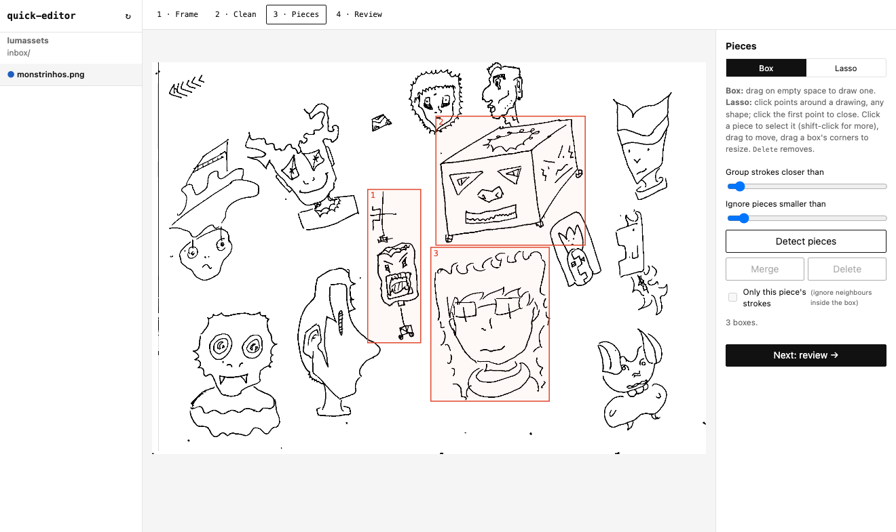

# quick-editor

quick-editor is a little tool by [Luma Montes][luma] for turning photos of drawings into clean, transparent SVGs. I made it to get drawings out of my notebooks and into [Lumassets][lumassets].



It runs on your machine and opens in the browser. Put a scan or photo in the inbox, then work through **Frame**, **Clean**, **Pieces**, and **Review**. Straighten the page, adjust what counts as ink, and draw a box or lasso around each piece you want to keep. You can stop and come back to the same page later.

## Install and run

Install [uv][uv] and potrace. On macOS with Homebrew:

```sh
brew install uv potrace
uv tool install git+https://github.com/lumamontes/quick-editor
```

From the folder where you keep your drawings:

```sh
quick-editor init
quick-editor
```

Put photos in `inbox/` and select one at [localhost:4400](http://localhost:4400). JPG, PNG, HEIC, AVIF, TIFF, and WebP all work. Use `quick-editor --project <folder>` to open a different project.

## What it saves

- A transparent, recolorable SVG per drawing in `out/vector/`. Add a solid backing shape in Review if you want one.
- A cleaned PNG at the cropped source resolution in `out/originals/`.
- A draft entry in `out/catalog.json`, and your per-photo progress in `sessions/`.

Change these paths in `quick-editor.toml` to use your own project layout. The [Lumassets asset guide][guide] shows how it works with a real library.

## Refit a drawing

If you find a sharper scan, put it in the inbox and try:

```sh
quick-editor refit sq1-06
quick-editor refit sq1-06 --apply
```

The first command opens a before-and-after report. The second writes the new SVG and updates the catalog. Run `quick-editor refit` without an ID to review published drawings that still have a bitmap embedded in their SVG.

## Technology

**OpenCV** straightens pages and finds pieces, **scikit-image** separates ink from paper, and **potrace** traces the ink into SVG paths. **Pillow** and **pillow-heif** open the photos. The editor is plain HTML and JavaScript, served locally by **Starlette** and **Uvicorn**.

To run the tests from a clone:

```sh
uv run --with pytest pytest -q
```

## License

The code is [MIT](LICENSE).

[luma]: https://lumamontes.com
[lumassets]: https://lumassets.bibliotecadezines.workers.dev/
[uv]: https://docs.astral.sh/uv/
[guide]: https://github.com/lumamontes/lumassets/blob/main/docs/adding-assets.md
